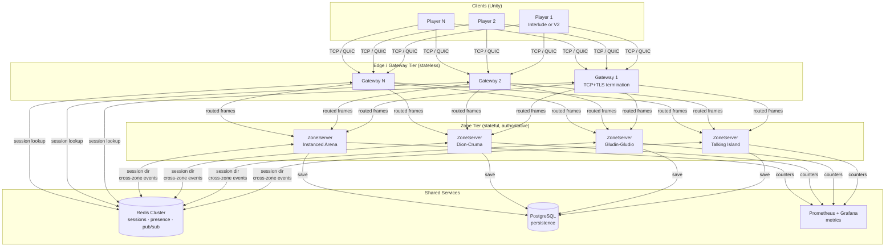

# Fineage Network Architecture

Target: **~20 000 concurrent players**, multi-region zone servers,
shared cache, authoritative simulation — built incrementally from the current
single-process `ZoneServer` skeleton.

> **This is a living design doc.**
> It describes the *target* architecture and the *phased path* to get there.
> Only the MVP foundation (Phase 0) is implemented in the initial PR;
> everything else is tracked as GitHub issues.

---

## Principles

| # | Principle | Why |
|---|-----------|-----|
| 1 | **Monolith first** | Don't split into micro-services until a single server can't handle the load. Current ZoneServer is a single process — that's fine for v0.3–v0.7 and even early content testing. |
| 2 | **One writer per piece of state** | Every entity (player, NPC, item) has exactly one authoritative process. No distributed locks on hot paths. |
| 3 | **Server-authoritative simulation** | Clients send intent (MoveTo, UseSkill); the server decides outcomes. Client-side prediction hides latency. |
| 4 | **Interface now, implementation later** | Abstractions for sessions, cache, AOI, and transport are defined early. Swap in-memory stubs for Redis/grid implementations when scale demands it. |
| 5 | **Interlude path stays working** | Dual-adapter (Interlude wire + V2 MessagePack) remains; V2 is the future, but Interlude regression must not break. |
| 6 | **Observe, then scale** | Add metrics/counters before adding nodes. Know where the bottleneck is before splitting. |

---

## What NOT to do (anti-patterns)

- **Premature microservices**: don't split login/zone/chat/party into 6 services
  at 50 CCU. One process with clean module boundaries scales to thousands.
- **Redis in the hot loop**: Redis is great for session directory, presence, and
  cross-zone pub/sub. Do NOT put it in the per-tick movement validation path.
- **Full-world broadcast**: never send every entity update to every player.
  Even with 100 players, quadratic replication is a latency and bandwidth wall.
- **Floating-origin distributed state**: the Interlude world coordinate space
  is bounded (~256 km²). Single coordinate space, no 64-bit doubles needed.
- **Over-engineering AOI day one**: a flat "everyone sees everyone" approach
  is fine while player count is <50 per zone. The interface is in place for later.

---

## Target Architecture (20k CCU)



### Tier breakdown

| Tier | Responsibility | State | Scale strategy |
|------|---------------|-------|---------------|
| **Client** | Render, predict, send intent | Local prediction state | N/A |
| **Gateway** | TLS termination, auth token validation, route to zone, backpressure | None (session→zone mapping in Redis) | Horizontal: add instances behind L4 LB |
| **Zone** | Authoritative sim tick (20 Hz), AOI filter, entity state, combat | All entity state for its region | Vertical first (bigger box), then split regions |
| **Redis** | Session directory, cross-zone pub/sub, presence, guild/party fan-out | Ephemeral + TTL | Redis Cluster with replicas |
| **PostgreSQL** | Character save, inventory, quest progress | Durable | Single-writer primary + read replicas |

### Data flow — single move

```
Client                  Gateway               ZoneServer
  │                        │                       │
  │─── MoveTo(dest) ──────►│                       │
  │   (predict locally)    │── route(sessionId) ──►│
  │                        │                       │── validate(geodata)
  │                        │                       │── update authoritative pos
  │                        │                       │── AOI: who sees this?
  │                        │◄─ MoveToAck(all vis) ─│
  │◄── MoveToAck ──────────│                       │
  │   (reconcile/interp)   │                       │
```

---

## AOI / Interest Management

Interlude visibility ranges are roughly **2000–3000 L2 world units** (~200–300 m
in Unity scale). The world is ~256 km².

### Grid-based spatial hashing (target)

```
cell_size = 3000 L2 units (≈ visibility radius)
grid_x    = floor(entity.X / cell_size)
grid_y    = floor(entity.Y / cell_size)
cell_key  = (grid_x, grid_y)  → 64-bit packed int

Player AOI = entities in own cell + 8 adjacent cells (3×3 neighborhood)
```

**MVP (now)**: `IAoiProvider` interface with `SingleCellAoi` — everyone in the
same zone sees everyone. Drop-in replacement for grid later.

**Phase 1**: `GridAoiProvider` with `Dictionary<long, HashSet<int>>` — no Redis,
pure in-memory, single process. Enough for hundreds of players per zone.

**Phase 2**: Cross-zone AOI at zone boundaries (ghost/shadow entities) — only
needed when zones are on different processes.

---

## Session & Connection Model

```csharp
// Defined in Net/ISession.cs
interface ISession {
    int    SessionId   { get; }
    string Account     { get; }
    bool   Authenticated { get; }
    bool   InWorld     { get; }
    int    EntityId    { get; }  // authoritative object id
    ValueTask SendAsync<T>(ushort msgType, T payload, CancellationToken ct);
    void   Disconnect(string reason);
}
```

Sessions are tracked in `ISessionStore` — an in-memory
`ConcurrentDictionary` now, replaceable with a Redis-backed directory later.

### Why not just PlayerSession?

`PlayerSession` currently owns the TCP socket, game state, and message handling.
Separating the *connection* (transport) from the *session* (identity + state)
allows:

- Gateway tier to own the connection, zone to own the session
- Reconnection without losing session state
- Unit testing game logic without TCP

---

## Message Codec & Registry

The existing `MsgType` enum + `[MessagePackObject]` classes work well.
The foundation adds:

- **`IMessageRegistry`** — maps `ushort msgType` ↔ `Type` for dispatch.
- **Protocol version in Hello** — already present (`ProtocolVersion` field).
  The registry can gate which messages are valid for a given version.
- **Versioning hook**: when adding fields to a MessagePack object, append new
  `[Key(N+1)]` — MessagePack skips unknown keys, so old clients decode fine.

No breaking changes to existing wire format.

---

## Distributed Cache

```csharp
// Defined in Net/IDistributedCache.cs
interface IDistributedCache {
    ValueTask<T?>  GetAsync<T>(string key, CancellationToken ct);
    ValueTask      SetAsync<T>(string key, T value, TimeSpan? ttl, CancellationToken ct);
    ValueTask      RemoveAsync(string key, CancellationToken ct);
}
```

**MVP**: `MemoryCache` implementation — `ConcurrentDictionary` with optional TTL.
No external dependency required to run locally.

**Scale**: `RedisCache` implementation — swap via DI. Used for:
- Session directory (which zone owns sessionId X?)
- Cross-zone presence (guild online list, party state)
- NOT for per-tick game state

---

## Simulation Tick

Current ZoneServer is event-driven (process message → respond). Target:

```
20 Hz fixed tick (50 ms):
  1. Drain inbound message queue (bounded)
  2. Apply validated inputs to entity state
  3. Run AI / combat / buff systems
  4. Compute deltas from previous tick
  5. AOI filter → send only changed + visible entities
  6. Emit metrics (tick duration, entity count, msg backlog)
```

Backpressure: if inbound queue exceeds threshold, drop oldest movement
inputs (stale anyway) and log slow-consumer metric.

---

## Transport Future: TCP → QUIC

Current: TCP (reliable, ordered). Fine for Interlude-like gameplay where
most packets are reliable (skills, chat, inventory).

Future consideration:
- **QUIC** (via `System.Net.Quic` in .NET 9+): multiplexed streams avoid
  head-of-line blocking. Movement on unreliable stream, skills on reliable.
- **UDP** with custom reliability: more control, more work. Not worth it
  for Interlude gameplay tempo.

The `ITransport` / `ISession` abstraction allows swapping without touching
game logic.

---

## Phased Path: Current → 20k

| Phase | CCU target | What changes | What stays |
|-------|-----------|-------------|------------|
| **0 (this PR)** | 1–10 | Abstractions: ISession, ISessionStore, IMessageRegistry, IAoiProvider, IDistributedCache. In-memory impls. Client IZoneTransport. | PlayerSession logic, wire format, selftest |
| **1 (v0.4–v0.5)** | 10–100 | GridAoiProvider, NpcInfo broadcast, combat tick loop, bounded inbound queue | Single process, TCP |
| **2 (v0.7)** | 100–1000 | Metrics (Prometheus), backpressure policy, connection rate limit, load-test harness | Single process |
| **3** | 1000–5000 | Gateway process (TLS termination, routing), Redis session directory, separate zone processes per region | Wire format unchanged |
| **4** | 5000–20000 | Multi-zone cluster, cross-zone AOI, PostgreSQL persistence, QUIC transport option, auto-scaling | Core game logic unchanged |

---

## Folder Layout (zone-server after this PR)

```
tools/zone-server/
├── Program.cs                  # entry point (unchanged)
├── SelfTest.cs                 # smoke test (unchanged)
├── ZoneLog.cs                  # logging (unchanged)
├── Fineage.ZoneServer.csproj
├── Session/
│   └── PlayerSession.cs        # existing game logic (unchanged)
├── Net/
│   ├── ISession.cs             # session abstraction
│   ├── ISessionStore.cs        # session registry
│   ├── MemorySessionStore.cs   # in-memory impl
│   ├── IMessageRegistry.cs     # opcode ↔ Type map
│   ├── MessageRegistry.cs      # default impl with versioning
│   ├── IDistributedCache.cs    # cache abstraction
│   └── MemoryCache.cs          # in-memory impl with TTL
└── Interest/
    ├── IAoiProvider.cs          # area-of-interest abstraction
    └── SingleCellAoi.cs         # trivial "see all" impl
```

Client side (Unity):
```
l2-unity/Assets/Scripts/Networking/Adapters/V2/
├── IZoneTransport.cs           # transport abstraction for GameManager
└── ... existing files unchanged
```
