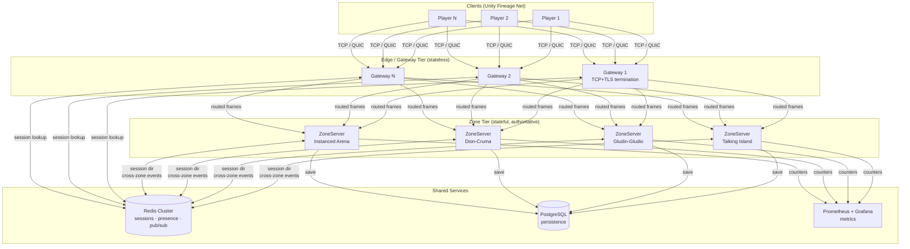

# Fineage Network Architecture

Target: **~20 000 concurrent players**, multi-region zone servers,
shared cache, authoritative simulation — built incrementally from the current
single-process `ZoneServer` skeleton.

> **This is a living design doc.**
> It describes the *target* architecture and the *phased path* to get there.
> Only the MVP foundation (Phase 0) is implemented in the initial PR;
> everything else is tracked as GitHub issues.

---

## Principles

| # | Principle | Why |
|---|-----------|-----|
| 1 | **Monolith first** | Don't split into micro-services until a single server can't handle the load. Current ZoneServer is a single process — that's fine for v0.3–v0.7 and even early content testing. |
| 2 | **One writer per piece of state** | Every entity (player, NPC, item) has exactly one authoritative process. No distributed locks on hot paths. |
| 3 | **Server-authoritative simulation** | Clients send intent (MoveTo, UseSkill); the server decides outcomes. Client-side prediction hides latency. |
| 4 | **Interface now, implementation later** | Abstractions for sessions, cache, AOI, and transport are defined early. Swap in-memory stubs for Redis/grid implementations when scale demands it. |
| 5 | **Net wire is primary** | Fineage Net (`PacketEnvelope`) is the only client path. The MessagePack V2 adapters and the `FINEAGE_V2_WIRE` flag were retired in #562–#568. |
| 6 | **Observe, then scale** | Add metrics/counters before adding nodes. Know where the bottleneck is before splitting. |
| 7 | **Postgres early, cluster late** | Durable `IAccountStore` on PostgreSQL is foundation now. Gateway / Redis / multi-zone wait until CCU demands them — interfaces first (`IHandoffStore`). |

---

## What NOT to do (anti-patterns)

- **Premature microservices**: don't split login/zone/chat/party into 6 services
  at 50 CCU. One process with clean module boundaries scales to thousands.
- **Redis in the hot loop**: Redis is great for session directory, presence, and
  cross-zone pub/sub. Do NOT put it in the per-tick movement validation path.
- **Full-world broadcast**: never send every entity update to every player.
  Even with 100 players, quadratic replication is a latency and bandwidth wall.
- **Floating-origin distributed state**: the Interlude world coordinate space
  is bounded (~256 km²). Single coordinate space, no 64-bit doubles needed.
- **Over-engineering AOI day one**: a flat "everyone sees everyone" approach
  is fine while player count is <50 per zone. The interface is in place for later.

---

## Target Architecture (20k CCU)



### Tier breakdown

| Tier | Responsibility | State | Scale strategy |
|------|---------------|-------|---------------|
| **Client** | Render, predict, send intent | Local prediction state | N/A |
| **Gateway** | TLS termination, auth token validation, route to zone, backpressure | None (session→zone mapping in Redis) | Horizontal: add instances behind L4 LB |
| **Zone** | Authoritative sim tick (20 Hz), AOI filter, entity state, combat | All entity state for its region | Vertical first (bigger box), then split regions |
| **Redis** | Session directory, cross-zone pub/sub, presence, guild/party fan-out | Ephemeral + TTL | Redis Cluster with replicas |
| **PostgreSQL** | Character save, inventory, quest progress | Durable | Single-writer primary + read replicas |

### Data flow — single move

```
Client                  Gateway               ZoneServer
  │                        │                       │
  │─── MoveTo(dest) ──────►│                       │
  │   (predict locally)    │── route(sessionId) ──►│
  │                        │                       │── validate(geodata)
  │                        │                       │── update authoritative pos
  │                        │                       │── AOI: who sees this?
  │                        │◄─ MoveToAck(all vis) ─│
  │◄── MoveToAck ──────────│                       │
  │   (reconcile/interp)   │                       │
```

---

## AOI / Interest Management

Interlude visibility ranges are roughly **2000–3000 L2 world units** (~200–300 m
in Unity scale). The world is ~256 km².

### Grid-based spatial hashing (target)

```
cell_size = 3000 L2 units (≈ visibility radius)
grid_x    = floor(entity.X / cell_size)
grid_y    = floor(entity.Y / cell_size)
cell_key  = (grid_x, grid_y)  → 64-bit packed int

Player AOI = entities in own cell + 8 adjacent cells (3×3 neighborhood)
```

**Now (2026-11):** hosted Zone defaults to **`GridAoi`** (`FINEAGE_ZONE_AOI_CELL`, default **3000**).
`RangeAoi` via `FINEAGE_ZONE_INTEREST_RANGE` when cell is `0`. `SingleCellAoi` only for tiny
test hosts (`FINEAGE_ZONE_AOI_CELL=0` and interest range `0`) — full Interlude datapack must not use it.

Interfaces live under Backend `Fineage.Zone.Interest` (`IAoi`, `GridAoi`, …). The older
`IAoiProvider` / `tools/zone-server` sketch below is historical naming.

**Later:** Cross-zone AOI at zone boundaries (ghost/shadow entities) — only when zones are
on different processes (#125).

---

## Session & Connection Model

```csharp
// Defined in Net/ISession.cs
interface ISession {
    int    SessionId   { get; }
    string Account     { get; }
    bool   Authenticated { get; }
    bool   InWorld     { get; }
    int    EntityId    { get; }  // authoritative object id
    ValueTask SendAsync<T>(ushort msgType, T payload, CancellationToken ct);
    void   Disconnect(string reason);
}
```

Sessions are tracked in `ISessionStore` — an in-memory
`ConcurrentDictionary` now, replaceable with a Redis-backed directory later.

### Why not just PlayerSession?

`PlayerSession` currently owns the TCP socket, game state, and message handling.
Separating the *connection* (transport) from the *session* (identity + state)
allows:

- Gateway tier to own the connection, zone to own the session
- Reconnection without losing session state
- Unit testing game logic without TCP

---

## Message Codec & Registry

**Live wire:** `Fineage.Net.Contract` — `PacketEnvelope`, `NetOpcode`, `NetCodec` / framing.
Unity keeps a verbatim copy under `Assets/Scripts/Networking/Net/Contract/**`, synced by
`scripts/sync-net-contract.py`.

**Retired:** MessagePack Zone V2 (`MsgType` + `[MessagePackObject]` as the client transport).
`Fineage.Protocol.MsgType` remains on the backend as legacy numbering for `*-v2-protocol.md`
semantics docs only — not the on-wire table.

Versioning hook for Net: append fields carefully in contract DTOs; gate with Hello /
`ProtocolVersion` when layouts diverge. Target chronicle is **Interlude** until that
slice is stable — see [DOC_CANON.md](DOC_CANON.md). Do not open a second chronicle
in the contract until then.

---

## Distributed Cache

```csharp
// Defined in Net/IDistributedCache.cs
interface IDistributedCache {
    ValueTask<T?>  GetAsync<T>(string key, CancellationToken ct);
    ValueTask      SetAsync<T>(string key, T value, TimeSpan? ttl, CancellationToken ct);
    ValueTask      RemoveAsync(string key, CancellationToken ct);
}
```

**MVP**: `MemoryCache` implementation — `ConcurrentDictionary` with optional TTL.
No external dependency required to run locally.

**Scale**: `RedisCache` implementation — swap via DI. Used for:
- Session directory (which zone owns sessionId X?)
- Cross-zone presence (guild online list, party state)
- NOT for per-tick game state

---

## Simulation Tick

**Current:** mostly event-driven (process message → respond) plus periodic world work
(regen tick, NPC AI timers, cast/attack deadlines). Global `ZoneWorld` `_gate` serializes
mutations today — acceptable for MVP; single-writer simulation actor is Phase D / #116.

**Target (hybrid, not “update every entity every 50 ms”):**

```
Authoritative order (fixed tick and/or scheduled events):
  1. Drain inbound command queue (bounded; critical ≠ DropOldest)
  2. Apply validated intents
  3. AI / combat / buff / regen on their own cadences
  4. AOI filter → presence fanout
  5. Metrics (tick duration, online, queues)
```

See [REFACTOR_PLAN_2026-11.md](REFACTOR_PLAN_2026-11.md). Do not treat 20k CCU diagrams above as shipped.

---

## Transport Future: TCP → QUIC

Current: TCP (reliable, ordered). Fine for Interlude-like gameplay where
most packets are reliable (skills, chat, inventory).

Future consideration:
- **QUIC** (via `System.Net.Quic` in .NET 9+): multiplexed streams avoid
  head-of-line blocking. Movement on unreliable stream, skills on reliable.
- **UDP** with custom reliability: more control, more work. Not worth it
  for Interlude gameplay tempo.

The `ITransport` / `ISession` abstraction allows swapping without touching
game logic.

---

## Phased Path: Current → 20k

Status vs epic **#112** (2026-11-08). Target numbers are design goals, not measured capacity.

| Phase | CCU target | Status | Notes |
|-------|-----------|--------|-------|
| **0** | 1–10 | **Done** | Net wire, Postgres accounts, Login+Zone, client NetSession |
| **1** | 10–100 | **Mostly done** | `GridAoi` default (#115 closed); presence/combat live; full 20 Hz actor still #116 |
| **2** | 100–1000 | **Partial** | Prometheus `/metrics` exists; #117/#119/#121 still open for full AC + load bots |
| **3** | 1000–5000 | Later | Gateway+TLS (#113), Redis (#114), multi-zone |
| **4** | 5000–20000 | Later | Cluster AOI (#125), QUIC (#123) |

Near-term harden/modularize work (not 20k): [REFACTOR_PLAN_2026-11.md](REFACTOR_PLAN_2026-11.md).

---

## Code layout (live)

Server lives in **Fineage-Backend** (`src/Fineage.Login`, `src/Fineage.Zone`, `src/Fineage.Net.Contract`, …) — not the historical `tools/zone-server/` sketch.

```
Fineage-Backend/src/
├── Fineage.Login/          # lobby + HTTP auth API
├── Fineage.Zone/           # world + NetZoneServer projection
│   ├── World/ZoneWorld*.cs
│   ├── Interest/GridAoi.cs
│   └── Net/
├── Fineage.Net.Contract/   # SoT codec (client syncs a copy)
└── Fineage.Accounts/       # Postgres + handoff
```

Client (Unity):
```
l2-unity/Assets/Scripts/Networking/Net/
├── Domain/IZoneTransport.cs + FineageZoneTransport.cs
├── Contract/               # synced from Backend
└── … NetSession / NetMainThreadPump / PacketServices
```
